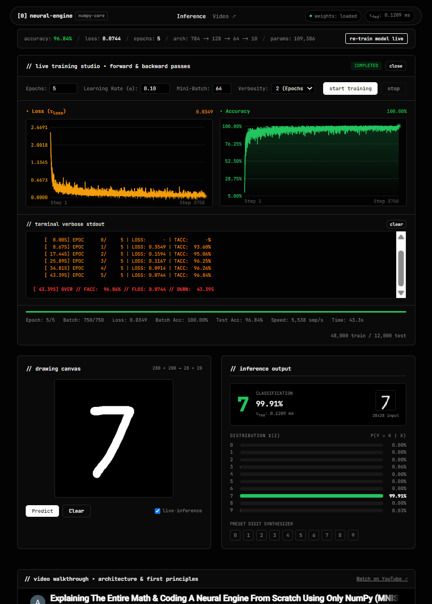

# Neural Engine NumPy


A lightweight deep learning framework built entirely from first principles using pure Python and NumPy. No black-box autograd, no PyTorch, no TensorFlow, no scikit-learn.



## Resources

- **Video Walkthrough:** [YouTube Video](https://youtu.be/KnZg2GKFDcQ)
- **Calculus Derivations:** Reference [`docs/NEURAL ENGINE.pdf`](docs/NEURAL%20ENGINE.pdf) in this repository for the full backpropagation proofs and mathematical derivations.

---

## Highlights & Features

- **Pure NumPy Core:** Forward and backward passes derived and implemented directly in vectorized NumPy matrix operations.
- **Interactive Live Training Studio:**
  - Real-time training control from the web interface: **Start**, **Pause**, **Resume**, **Stop**, and save checkpoints mid-run.
  - Streaming Server-Sent Events (SSE) telemetry over `/train` and `/train/<action>`.
  - Dual live-updating canvas curves for Cross-Entropy Loss ($\tau_{\text{loss}}$) and Evaluation Accuracy.
  - Interactive terminal emulator with ANSI color-coded verbose stdout streaming and verbosity levels (Summary, Epochs, Batches).
  - Telemetry HUD showing current epoch, batch, sample processing speed ($\text{samples/sec}$), elapsed time ($\tau_{\text{train}}$), and parameters.
- **Interactive Inference & Preprocessing:**
  - 280×280 responsive drawing canvas with dynamic brush strokes and live-inference toggling.
  - MNIST preprocessing pipeline: automatic bounding-box cropping, 20×20 aspect-ratio scaling, 28×28 canvas padding, and center-of-mass alignment matching the true MNIST distribution.
  - Live 28×28 "Model Vision" thumbnail preview.
  - Sub-millisecond CPU forward-pass latency ($\tau_{\text{fwd}}$) measurement.
  - Full 10-class Softmax probability distribution bars $\sigma(z) = P(y = k \mid x)$.
  - Preset digit synthesizer (0–9) for instant canonical validation.
- **Frosty Glassmorphism Design:** Modern dark UI aesthetic with cursor-tracking spotlight illumination (`spotlight.js`) and modular CSS.
- **Stream-Driven Architecture:** Generator-based training loop (`Sequential.stream(...)`) enabling clean decoupling between the training runtime and consumers (web SSE, CLI, or custom progress handlers).

---

## Project Structure

```text
neural-engine-numpy/
├── data/              # Raw datasets (data.csv tracked via Git LFS)
├── docs/              # Mathematical derivations and calculus notes (NEURAL ENGINE.pdf)
├── model/             # Saved checkpoints, telemetry logs, and stats
│   ├── model_stats.json       # Top-level model metrics & topology
│   ├── model_train_log.json   # Full step & epoch telemetry history
│   └── model_weights.npz      # Compressed He-initialized parameter checkpoints
├── nn/                # Pure NumPy neural network framework
│   ├── layers.py      # Layer base class, Dense, ReLU, SoftmaxCrossEntropy
│   ├── models.py      # Sequential container with stream(), fit(), and pause/resume
│   ├── optimizers.py  # SGD and RMSProp optimizer implementations
│   └── utils.py       # Numerically stable softmax, one_hot, accuracy, load_mnist
├── scripts/           # Training and evaluation entry points
│   └── test.py        # CLI training and evaluation script
├── thumb.png          # Web studio preview screenshot
└── web/               # Flask interactive web application
    ├── app.py         # Flask server with /predict and /train SSE endpoints
    ├── preprocess.py  # Canvas preprocessor (aspect crop, centering, center-of-mass shift)
    ├── static/        # Static assets
    │   ├── assets/    # SVGs (favicon.svg, blank28.svg)
    │   ├── css/       # Modular styles (base.css, layout.css, inference.css, studio.css)
    │   ├── fonts/     # Typography (JetBrainsMono.woff2)
    │   └── js/        # Modular scripts (canvas.js, predict.js, train.js, spotlight.js)
    └── templates/     # UI templates (base.html, index.html)
```

---

## Mathematical Architecture

### Baseline Model
$$\text{Input (784)} \xrightarrow{\text{Dense}} \text{Hidden}_1 (128) \xrightarrow{\text{ReLU}} \text{Hidden}_2 (64) \xrightarrow{\text{ReLU}} \text{Output} (10) \xrightarrow{\text{Softmax Cross-Entropy}} \mathcal{L}$$

- **Trainable Parameters:** 109,386 ($W_1: 128 \times 784$, $b_1: 128 \times 1$, $W_2: 64 \times 128$, $b_2: 64 \times 1$, $W_3: 10 \times 64$, $b_3: 10 \times 1$)
- **Weight Initialization:** He Normal distribution to preserve variance across ReLU layers:
  $$W \sim \mathcal{N}\left(0, \sqrt{\frac{2}{d_{\text{in}}}}\right), \quad B = \mathbf{0}_{(d_{\text{out}}, 1)}$$
- **Numerical Stability:**
  - Softmax max-logit shift: $\mathrm{softmax}(z)_i = \frac{e^{z_i - \max(z)}}{\sum_j e^{z_j - \max(z)}}$ to prevent floating-point overflow.
  - Cross-entropy probability clipping: $\hat{y} \leftarrow \mathrm{clip}(\hat{y}, 10^{-15}, 1 - 10^{-15})$ to avoid $\log(0)$.

### Layer Formulations

| Layer | Forward Pass | Backward Pass |
| :--- | :--- | :--- |
| **Dense** | $Z = W A_{\text{prev}} + B$ | $dW = \frac{1}{m} dZ A_{\text{prev}}^T$<br>$dB = \frac{1}{m} \sum_{i=1}^m dZ^{(i)}$<br>$dA_{\text{prev}} = W^T dZ$ |
| **ReLU** | $A = \max(0, Z)$ | $dZ = dA \odot \mathbf{1}_{\{Z > 0\}}$ |
| **Softmax + Cross-Entropy** | $\mathcal{L} = -\frac{1}{m} \sum \left( Y \odot \log(\hat{Y}) \right)$ | $dZ = \hat{Y} - Y$ |

---

## Quick Start

### 1. Pull Dataset (Git LFS)

The dataset (`data/data.csv`) is tracked via [Git LFS](https://git-lfs.com/). Install Git LFS:

- **macOS:**
  ```bash
  brew install git-lfs
  ```
- **Linux:**
  ```bash
  sudo apt install git-lfs      # Debian / Ubuntu
  sudo dnf install git-lfs      # Fedora / RHEL
  sudo pacman -S git-lfs        # Arch Linux
  ```
- **Windows:**
  ```powershell
  winget install GitHub.GitLFS  # or choco install git-lfs
  ```

Pull the dataset files:

```bash
git lfs install && git lfs pull
```

### 2. Install Dependencies

```bash
pip install -r requirements.txt
```

### 3. Launch Interactive Web App

```bash
python web/app.py
```

Navigate to `http://127.0.0.1:5000` in your web browser.

---

## Python Usage & Custom Models

### CLI Training Script

Run the built-in CLI training script:

```bash
python scripts/test.py
```

### Building Custom Networks

```python
import numpy as np
from nn.layers import Dense, ReLU, SoftmaxCrossEntropy
from nn.optimizers import SGD
from nn.models import Sequential
from nn.utils import load_mnist

# 1. Load dataset (80/20 train/test split)
X_train, Y_train, X_test, Y_test = load_mnist("data/data.csv", sp=0.8)

# 2. Assemble Sequential model
model = Sequential(
    layers=[
        Dense(784, 128),
        ReLU(),
        Dense(128, 64),
        ReLU(),
        Dense(64, 10),
        SoftmaxCrossEntropy()
    ],
    optimizer=SGD(lr=0.1)
)

# 3. Synchronous training with terminal telemetry
# Automatically persists checkpoints to model/ upon completion
telemetry = model.fit(
    X_train, Y_train, X_test, Y_test,
    epochs=10,
    batch_size=64,
    verbose=2
)

# 4. Forward inference
probs = model.predict(X_test)
```

### Generator Event Streaming

The training engine exposes a generator stream that yields structured JSON events at every batch and epoch:

```python
for event in model.stream(X_train, Y_train, X_test, Y_test, epochs=10, batch_size=64):
    if event["type"] == "epoch":
        print(f"Epoch {event['epoch']}/{event['total_epochs']} - Loss: {event['loss']:.4f} - Acc: {event['accuracy']:.2f}%")
```

---

## Web API Endpoints

The Flask server provides endpoints for inference, streaming training, and runtime state control:

| Endpoint | Method | Description |
| :--- | :--- | :--- |
| `/` | `GET` | Serves the main UI populated with checkpointed telemetry stats |
| `/predict` | `POST` | Accepts `{ "image": "<base64_data_uri>" }`, returns predicted digit, confidence, distribution array, preview image, and $\tau_{\text{fwd}}$ |
| `/train` | `GET` | SSE stream for live training: `/train?epochs=10&lr=0.1&batch_size=64` |
| `/train/start` | `GET`/`POST`| Re-initializes model weights (He Normal) and begins SSE stream |
| `/train/pause` | `GET`/`POST`| Pauses the training loop while preserving intermediate parameters |
| `/train/resume`| `GET`/`POST`| Resumes paused training execution |
| `/train/stop`  | `GET`/`POST`| Stops training gracefully and writes current checkpoints to disk |
| `/train/save`  | `GET`/`POST`| Manually checkpoints current model weights and stats |

---

## Benchmark

_Dataset: MNIST (60,000 samples, 80/20 train/test split) | Batch Size: 64 | Learning Rate: 0.1 | Optimizer: SGD_

| Epoch | Training Loss | Training Acc | Test Acc | Elapsed ($\tau$) |
| :---: | :-----------: | :----------: | :------: | :--------------: |
|   1   |    0.3547     |    92.98%    |  94.12%  |      ~11.5s      |
|   5   |    0.0640     |    98.65%    |  96.87%  |      ~57.4s      |
|  10   |    0.0313     |    99.43%    |  97.50%  |     ~114.8s      |

---

## Roadmap

Upcoming enhancements and planned features:

- **Advanced Optimizers:**
  - **Adam:** Adaptive moment estimation with first and second moment tracking.
  - **RMSProp:** Full implementation of root mean square propagation.
  - **SGD + Momentum:** Velocity vectors to accelerate convergence through ravines and flat regions.
- **Regularization:**
  - **Dropout:** Random inverted dropout masks during training passes.
  - **Early Stopping:** Automatic halt when validation loss stops decreasing.
- **Architecture & Extensibility:**
  - Dynamic layer configuration via the web studio UI.
  - Additional activation layers (LeakyReLU, Tanh, GELU).
  - Convolutional layers (Conv2D, MaxPool2D) implemented in pure NumPy.

---

## License

This project is licensed under the MIT License - see the [LICENSE](LICENSE) file for details.
